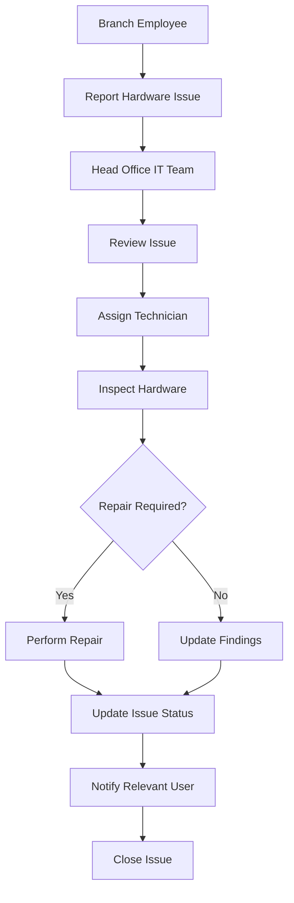

# 🖥️ Centralized IT Asset & Hardware Management System

<p align="center">
  A centralized platform for managing company hardware assets, tracking technical issues, and streamlining IT support across multiple branches.
</p>

<p align="center">
  
  
  
  
</p>

---

## 📌 Overview

The **Centralized IT Asset & Hardware Management System** is a web-based application designed to improve how organizations manage hardware assets and handle technical issues across their head office and branch locations.

The system provides a centralized environment where branch employees can report hardware problems, while the Head Office IT team can receive requests, inspect equipment, assign technicians, manage repairs, and monitor issue progress.

The main goal is to improve IT support operations, increase asset visibility, reduce manual communication, and maintain an organized record of hardware maintenance activities.

## 🎯 Project Objectives

- Centralize hardware asset information across multiple branches.
- Simplify hardware issue reporting for branch employees.
- Improve communication between branches and the Head Office IT team.
- Track inspections, technician assignments, and repair activities.
- Maintain a history of hardware issues and maintenance records.
- Provide better visibility into asset conditions and IT support performance.

## ✨ Key Features

### 👥 User Management
- Create and manage system users.
- Assign user roles and permissions.
- Manage user accounts and account status.
- Support role-based access control.

### 🏢 Organization & Branch Management
- Manage organization information.
- Register the Head Office and branch locations.
- Maintain branch contact information.
- Associate employees and assets with their respective branches.

### 💻 Asset Management
- Register and manage company hardware assets.
- Organize assets by category.
- Track asset codes, brands, models, and serial numbers.
- Record purchase dates and warranty information.
- Monitor asset availability and condition.

### 🛠️ Hardware Issue Reporting
- Allow branch employees to report hardware problems.
- Record issue descriptions and priorities.
- Associate reported issues with specific assets.
- Track issue status and reporting history.

### 🔧 Inspection & Repair Management
- Assign reported issues to IT technicians.
- Record inspection details and findings.
- Maintain repair descriptions and costs.
- Track repair progress and resolution.

### 📊 Dashboard & Reports
- Monitor registered assets.
- View reported and pending issues.
- Track repair activities.
- Generate operational insights and reports.

## 🔄 System Workflow



## 👤 User Roles

| Role | Responsibilities |
|---|---|
| Admin | Manage users, branches, assets, and system settings |
| IT Staff | Review issues, assign technicians, and manage IT operations |
| Branch Manager | Monitor branch assets and reported issues |
| Branch User | View assigned branch assets and report hardware issues |

## 🧰 Technology Stack

### Frontend
- React.js
- JavaScript
- HTML5
- CSS3

### Backend
- Node.js
- Express.js
- RESTful APIs

### Database
- PostgreSQL

### Development & Testing Tools
- Visual Studio Code
- Postman
- Git & GitHub
- pgAdmin

### Security
- bcryptjs – Password hashing
- JSON Web Token (JWT) – Authentication
- Role-Based Access Control (RBAC)

## 🏗️ Project Architecture

The application follows a client-server architecture.

```text
centralized-it-asset-management/
│
├── frontend/
│   └── React Application
│
├── backend/
│   ├── src/
│   │   ├── config/
│   │   │   └── db.js
│   │   │
│   │   ├── controllers/
│   │   ├── middleware/
│   │   ├── models/
│   │   ├── routes/
│   │   ├── services/
│   │   │
│   │   ├── app.js
│   │   └── server.js
│   │
│   ├── .env
│   ├── .gitignore
│   └── package.json
│
└── README.md
```

## 🗄️ Database Design

The system uses PostgreSQL to store and manage organizational, user, asset, and maintenance information.

Main database tables:

| Table | Purpose |
|---|---|
| organizations | Organization information |
| branches | Head Office and branch details |
| roles | System user roles |
| users | User account information |
| asset_categories | Hardware categories |
| assets | Company hardware records |
| issues | Reported hardware issues |
| issue_assignments | Technician assignment records |
| inspections | Hardware inspection details |
| repairs | Repair activities and costs |
| issue_attachments | Issue-related files |
| notifications | User notifications |
| issue_status_history | Issue status tracking |

## ⚙️ Getting Started

Follow these instructions to run the project locally.

### 1. Clone the Repository

```bash
git clone https://github.com/YOUR_USERNAME/centralized-it-asset-management.git
```

### 2. Navigate to the Project

```bash
cd centralized-it-asset-management
```

### 3. Backend Setup

```bash
cd backend
npm install
```

### 4. Configure Environment Variables

Create a `.env` file inside the `backend` directory:

```env
PORT=5000

DB_HOST=localhost
DB_PORT=5432
DB_NAME=it_asset_management
DB_USER=postgres
DB_PASSWORD=your_database_password

JWT_SECRET=your_secure_secret
JWT_EXPIRES_IN=1d
```

**Important:** Replace the example credentials with your local configuration. Never commit your `.env` file to GitHub.

### 5. Database Setup

1. Open PostgreSQL using pgAdmin.
2. Create a database named `it_asset_management`.
3. Execute the database table creation SQL scripts.
4. Insert the required initial roles and sample data.

### 6. Start the Backend Server

```bash
npm run dev
```

Backend server:

```text
http://localhost:5000
```

Health check:

```text
http://localhost:5000/api/health
```

### 7. Frontend Setup

Once the frontend has been created:

```bash
cd frontend
npm install
npm run dev
```

## 🧪 API Testing

The backend REST APIs can be tested using **Postman**.

Current user management endpoints:

| Method | Endpoint | Description |
|---|---|---|
| GET | `/api/users` | Retrieve all users |
| GET | `/api/users/:id` | Retrieve a user |
| POST | `/api/users` | Create a user |
| PUT | `/api/users/:id` | Update a user |
| DELETE | `/api/users/:id` | Deactivate a user |

Authentication and additional API modules are part of the planned development.

## 🚀 Development Roadmap

- [x] Project planning and requirement identification
- [x] Database design and initial setup
- [x] Sample database records
- [x] Backend project initialization
- [x] User management REST API
- [ ] User authentication and authorization
- [ ] Organization and branch management API
- [ ] Asset management API
- [ ] Hardware issue reporting API
- [ ] Inspection and repair management
- [ ] React frontend development
- [ ] Dashboard and reporting
- [ ] System integration and testing
- [ ] Deployment

## 🔐 Security Considerations

The system is being developed with security as an important consideration.

Planned security measures include:

- Secure password hashing.
- JWT-based authentication.
- Role-based authorization.
- Branch-level data access restrictions.
- Input validation and error handling.
- Secure environment variable management.

## 🎯 Expected Outcome

The completed system aims to provide organizations with a reliable and centralized way to manage IT assets and hardware support operations. By connecting branch employees with the Head Office IT team through one platform, the application will help improve issue resolution, asset tracking, and overall IT service management.

## 👨‍💻 Developer

**Dhananji Pallegedara**

Information Technology Undergraduate | Software Developer

- GitHub: [DhanaM24](https://github.com/DhanaM24)
- Portfolio: [Personal Portfolio](https://dhananjipallegedara.vercel.app/)

---

<p align="center">
  <b>Built to simplify IT asset management and improve organizational support.</b>
</p>
